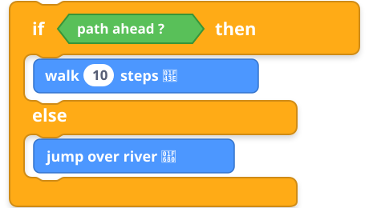
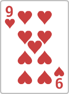
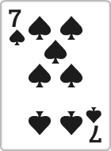

# 🚀 What If...? The Secret Superpower of Coding!
### Mission: Awaken Pixel the Bear's Decision Brain!

  

    
    <h3 class="text-xl font-bold text-purple-600">Meet Pixel the Bear! 🐾</h3>
    
"Hi super-coders! Today I need your brain superpower to make decisions!"

  

  
  

    🎮 QUICK WARM-UP GAME
    

      IF you wear BLUE today...
      
👉 Raise your hand up high! 🙋‍♂️

    

    

      IF you love Minecraft / Roblox...
      
👉 Give me a big gamer smile! 😁

    

  

<!--
Minute 00:00 - 01:00:
"Good afternoon, my awesome super-coders! How is everyone doing today? Awesome!
Before we start, let's play a super quick brain game!
IF you are wearing blue today... raise your hand up high!
Now... IF you love playing video games... give me a big smile!
Do you know what just happened? Your brain just executed a secret superpower called CONDITIONALS!"
-->

---
transition: slide-left
---

# 🌦️ Real-Life Logic: The Weather Dilemma
### Computers make choices just like you do every morning!

  

    

      CONDITION: TRUE
      🌧️
    

    <h3 class="text-lg font-bold text-blue-600">IF it is Raining outside...</h3>
    

      
      

        <h4 class="font-bold text-gray-800">THEN: Grab an Umbrella! ☂️</h4>
        
Stay 100% dry and safe!

      

    

  

  

    

      CONDITION: FALSE
      ☀️
    

    <h3 class="text-lg font-bold text-amber-600">ELSE (It is Sunny)...</h3>
    

      
      

        <h4 class="font-bold text-gray-800">THEN: Wear Cool Sunglasses! 😎</h4>
        
Enjoy the warm golden sunshine!

      

    

  

<!--
Minute 01:00 - 02:00:
"Now, how do computers and robots make decisions? They do it just like us!
IF it's raining outside... what do you grab? That's right, an umbrella!
ELSE... if it's sunny outside... what do you wear? Cool sunglasses!
In coding, IF checks if something is TRUE. And ELSE is our superhero backup plan when it's FALSE!"
-->

---
transition: slide-left
---

# 🧩 Connecting to Scratch: The Super-C Block
### Let's give Pixel the Bear his walking and jumping code!

  

    
  

  

    

      ⚠️ The River Dilemma!
    

    

      <strong>Question for Coders:</strong> 
      What happens if we forget the <code>ELSE</code> block when Pixel reaches the river?
    

    

      💡 <strong>The ELSE Hero:</strong> 
      Without <code>ELSE</code>, Pixel falls into the water! With <code>ELSE</code>, Pixel leaps over the river safely! 🚀
    

  

<!--
Minute 02:00 - 03:15:
"In Scratch, this superpower looks like a giant hungry mouth — we call it the C-Block!
Look at Pixel's code:
IF path ahead, THEN walk 10 steps!
ELSE... JUMP over the river!
Coders, what would happen if we FORGOT the ELSE block when Pixel reaches the river?
He would walk straight into the water! Splash!
That's why ELSE is so important — it's the backup plan that saves our robot!"
-->

---
transition: slide-left
---

# 🃏 Interactive Challenge: The Mystery Cards!
### Pick a card! Let's execute the code rule inside!

  👉 Rule: <strong>IF Red Card</strong> ➔ Draw 2 Cards! <strong>ELSE</strong> ➔ Jump 3 Times!

  

    
    CARD A: RED!
    
TRUE ➔ Draw 2 Cards! 🎴

  

  

    
    CARD B: BLUE!
    
FALSE ➔ Jump 3 Times! 🦘

  

<!--
Minute 03:15 - 04:15:
"Time for our Mystery Card Challenge! Who wants to pick first?
Here is our code rule:
IF the card is RED... you draw 2 cards!
ELSE... you have to do 3 super jumps!
Look at Card A... it's RED! Condition is TRUE!
Now Card B... it's BLUE! Condition is FALSE, so we execute ELSE!"
-->

---
transition: slide-left
---

# 🏆 Mission Accomplished! You Are Master Coders!
### Pixel the Bear is safe at home thanks to your IF-ELSE superpowers!

  

    
    <h3 class="text-2xl font-black text-purple-600">LEVEL 5 UNLOCKED!</h3>
    
Badge Awarded: Master of Decision Logic

  

  

    

      1️⃣
      

        <h4 class="font-bold text-purple-600">IF is the Question!</h4>
        
Checks whether something is TRUE or FALSE.

      

    

    

      2️⃣
      

        <h4 class="font-bold text-purple-600">ELSE is the Backup Plan!</h4>
        
Tells the computer what to do when it's NOT true.

      

    

    

      ✋ GIVE ME A VIRTUAL HIGH-FIVE! ✋
    

  

<!--
Minute 04:15 - 05:00:
"Look at that! We reached Level 5, and Pixel the Bear made it safely across the island!
Let's lock in our 2 golden superpowers today:
1. IF asks the question: Is this TRUE or FALSE?
2. ELSE is the hero backup plan: What to do when it's NOT true!
You all did an incredible job today! Can I get a virtual high-five on the camera? BAM!
Thank you super-coders, see you on our next mission!"
-->

